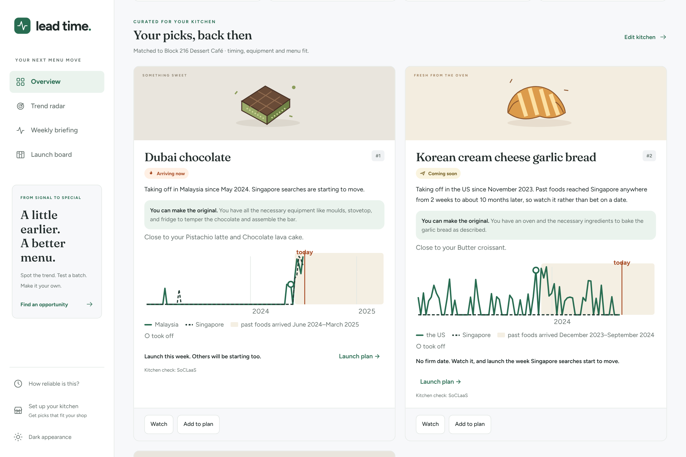
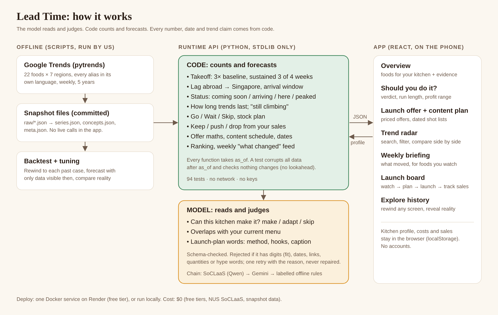

# Lead Time

**Which foods are taking off overseas, whether they're heading for Singapore, roughly when they'll land, and which ones your kitchen can actually make.**

ForgeHacks Online 2026 · AI + Business track

**Live demo:** https://lead-time-cjnn.onrender.com (free tier: the first visit after a quiet spell takes up to a minute to wake up). The overview opens immediately with a clearly labelled example dessert café. Choose **Personalise my picks** to configure your kitchen, or **Explore history** to rewind the evidence.

**Demo video:** (add YouTube link)



A dessert takes off in Seoul or Dubai and reaches Singapore some weeks later. By the time a small café hears about it, every other shop already has it on the menu. Lead Time measures that gap from five years of search history, applies it to what's rising abroad right now, and checks each candidate against your menu and equipment. You get three foods to try. Each one comes with its evidence, a launch date, the version your kitchen can make, and three ways to announce it.

## What a shop can do with it

| Screen | What it's for |
|---|---|
| **Overview** | Up to three foods heading for Singapore that this kitchen can make, each with the evidence, the version to make, and when to launch. |
| **Weekly briefing** | A weekly feed of what moved: new takeoffs abroad, foods arriving here, foods peaking. Foods on your board are tagged; one tap copies a plain-text brief for staff. |
| **Trend radar** | Search foods and origins, filter by status, category or saved items, sort by opportunity or name, and compare up to three foods side by side. |
| **Launch board** | A three-column Watch → Plan → Launched pipeline with a twelve-food planning limit. Planned foods get a launch timeline, a combined shopping list and the kit you're missing. Launched foods track weekly sales (exportable as CSV). |
| **Food page** | Opens with **Should you do it?**: Go / Go but late / Wait / Skip, with the reasons (timing, kitchen, overlap with your current menu, how long trends last here, your margin), a projected profit range from your own price and weekly-sales guess, and a stock plan (bulk-order until a date, then week by week). Below: evidence chart, launch plan (method outline, swaps, three video hooks, caption, offer), price helper, and the sales tracker. |
| **Launch offer** | Six offers (first N free, % off launch week, second half price, loyalty card, limited daily drop, bundle with something already on your menu), each priced against your own cost and price: what it costs, what you make on each, how much more you'd need to sell to come out even, and whether your kitchen can keep up. One is suggested for the moment you're in (early: buy attention; late: give a reason to pick you; waiting: protect margin), and offers you couldn't make back are flagged. |
| **Content plan** | A dated posting schedule around launch day (tease, announce, launch, reactions, follow-up), with a shot list for each post. Formats are picked from what the food is: things with fillings get the cut, things that crack get the crunch, drinks get the pour. The plan follows the offer you choose (a giveaway adds a line video, a daily drop adds a sold-out post). Tick posts off as you go, or copy the whole shot list for staff. |
| **After launch** | Log weekly sales and get a **keep / push / rethink / wind down** call that reads your sales against Singapore's curve: falling sales while searches are still up means the item is the problem, not the trend. The board totals sales, revenue and profit across everything you've launched. |
| **Explore history** | Rewind every screen above to any past date, using only data visible then, then reveal what happened. |

The responsive workspace includes light/dark appearance, a snapshot date on every screen, and global historical controls. The board supports JSON backup and validated restoration of missing foods; existing entries and the kitchen profile are not overwritten. Archiving a launch preserves its sales, costs and completed content posts. Board changes synchronise across open tabs.

Board, menu, costs and sales stay in the browser (`localStorage`); there are no accounts. Sales are sent to the API only to compute a review and are never stored.

## The rule

**The model reads and judges. Code counts and forecasts.**

- **Code** finds when each food took off in each country, measures how long foods took to reach Singapore, forecasts arrival windows, ranks results, and writes every date, trend sentence and link you see.
- **The model** does two jobs: it judges whether *this* kitchen can make a food (`make` / `adapt` / `skip`, plus a one-sentence reason), and it writes the words of the launch plan.
- Model output is schema-validated. It may not contain digits (for fit), or dates, years, links or quantities (for launch plans). Anything that fails is dropped and logged, never repaired. The next provider in the chain is tried.
- Every forecast can be rebuilt from the committed snapshot files with the model switched off. The test suite does exactly that.



```
seed concepts (aliases in each language)
        │
        ▼
FETCH  scripts/fetch_trends.py ──► data/raw/trends/*.json   (Google Trends, weekly, 5 years, 7 regions)
        │
        ▼
SERIES (code)   one weekly series per concept per region
TAKEOFF (code)  first week ≥3× baseline, sustained 3 of the next 4 weeks
LAG (code)      SG takeoff − first takeoff abroad, over past cases
WINDOW (code)   origin takeoff + 25th–75th percentile of past lags (≥4 cases or no window)
        │
        ▼
FIT (model)     can this shop make it?  make / adapt / skip     ← schema-checked
RANK (code)     arriving now › coming soon, make › adapt, earliest first
LAUNCH          date (code) + method, hooks, caption, offer (model) + video links (code)
```

## What's real and what isn't

- **Real:** Google Trends weekly search interest for 22 foods × 7 regions (SG, KR, JP, TW, AE, US, MY), fetched with `pytrends` and committed as raw JSON. The app reads snapshots only and never calls Google live. The snapshot date is always on screen.
- **Not used:** TikTok and Instagram. Scraping them breaks their terms. Search interest is a proxy for demand, not sales.
- **Compared:** timing only. Trends numbers are relative within one request, so each line on a chart is scaled to its own peak and magnitudes are never compared across regions.
- **Model:** SoCLaaS first (NUS School of Computing's OpenAI-compatible model service, open models like Qwen 3.5), Gemini second, then an `offline` rung of deterministic hand-written rules. That rung is labelled "offline rules" wherever it appears, so it works with no keys. The deployed demo shows which rung answered on every card.

## Backtest

`scripts/backtest_report.py`, output pasted unedited:

```
Lead Time backtest, snapshot to 2026-10-03
Constants: BASELINE_WEEKS=12 TAKEOFF_RATIO=3.0 SUSTAIN=(3, 4) MIN_BASELINE=2 MIN_TAKEOFF_VALUE=10 SMOOTH_WEEKS=3 BASELINE_GAP_WEEKS=0 MIN_CASES=4

concept                    from  origin wk   flagged     window then              SG actual   outcome        miss  warn
-----------------------------------------------------------------------------------------------------------------------
dubai-chocolate            MY    2024-05-19  2024-06-22  2024-06-02..2025-03-23   2024-06-09  already_here             
dubai-chewy-cookie         KR    2025-12-14  2026-01-17  2026-01-04..2027-02-28   2026-01-18  inside            0     0
tanghulu                   MY    2023-09-17  2023-10-21  -                        2023-10-08  already_here             
salt-bread                 MY    2025-03-23  2025-04-26  -                        2024-04-14  already_here             
yakgwa                     JP    2023-07-30  2023-09-02  -                        2025-11-30  no_forecast              
maritozzo                  US    2022-06-19  2022-07-23  -                        2021-12-26  already_here             
crookie                    US    2024-03-03  2024-04-06  -                        2024-03-10  already_here             
new-york-roll              TW    2023-12-03  2024-01-06  -                        2023-12-03  already_here             
croissant-cube             AE    2023-01-08  2023-02-11  -                        -           no_forecast              
sea-salt-coffee            US    2026-03-29  2026-05-02  2026-04-19..2027-06-06   -           pending                  
fruit-sando                US    2022-03-06  2022-04-09  -                        -           no_forecast              
souffle-pancake            KR    2022-07-03  2022-08-06  -                        2023-04-02  no_forecast              
einspanner                 US    2022-07-17  2022-08-20  -                        2023-09-17  no_forecast              
cream-cheese-garlic-bread  US    2023-11-19  2023-12-23  -                        -           no_forecast              
bomboloni                  TW    2023-08-13  2023-09-16  -                        2022-06-26  already_here             
yogurt-ice-cream           KR    2024-06-02  2024-07-06  2024-06-16..2025-04-06   2025-08-17  late             19    58
flat-croissant             US    2022-01-30  2022-03-05  -                        -           no_forecast              
croissant-taiyaki          KR    2025-03-16  2025-04-19  2025-04-06..2025-12-14   -           never_arrived            
dubai-strawberry-cup       US    2024-11-24  2024-12-28  2024-12-15..2025-08-24   -           never_arrived            
spanish-latte              TW    2024-03-31  2024-05-04  -                        2023-07-16  already_here             
brookie                    KR    2022-07-24  2022-08-27  -                        -           no_forecast              

Flagged abroad: 21  Forecasts judged: 4  Inside window: 1
Median miss (weeks, judged forecasts): 9.5  Median warning before SG takeoff (weeks): 58
Outcomes: inside=1, early=0, late=1, never_arrived=2, already_here=8, no_forecast=8, pending=1

Leave-one-out (ignores time order; checks whether lags generalise):
  dubai-chocolate             actual lag   3 wk   window from others 5-63 wk                 missed by 2 wk
  dubai-chewy-cookie          actual lag   5 wk   window from others 3-63 wk                 inside
  tanghulu                    actual lag   3 wk   window from others 5-63 wk                 missed by 2 wk
  yakgwa                      actual lag 122 wk   window from others 3-39 wk                 missed by 83 wk
  crookie                     actual lag   1 wk   window from others 4-62 wk                 missed by 3 wk
  souffle-pancake             actual lag  39 wk   window from others 3-63 wk                 inside
  einspanner                  actual lag  61 wk   window from others 3-51 wk                 missed by 10 wk
  yogurt-ice-cream            actual lag  63 wk   window from others 3-39 wk                 missed by 24 wk
  2 of 8 inside; median miss 2.5 weeks

Late entry (already in Singapore: is it still worth joining? rewound to the day SG takeoff was confirmed):
  dubai-chocolate             2024-07-13   4 wk in  call=go_late  actual: 67 wk left    right
  dubai-chewy-cookie          2026-02-21   4 wk in  call=go_late  actual: 31 wk left    right
  tanghulu                    2023-11-11   4 wk in  call=go_late  actual: 50 wk left    right
  salt-bread                  2024-05-18   4 wk in  call=skip     actual: 4 wk left     right
  yakgwa                      2026-01-03   4 wk in  call=skip     actual: 1 wk left     right
  maritozzo                   2022-01-29   4 wk in  call=skip     actual: 3 wk left     right
  crookie                     2024-04-13   4 wk in  call=skip     actual: 3 wk left     right
  new-york-roll               2024-01-06   4 wk in  call=go_late  actual: 7 wk left     right
  souffle-pancake             2023-05-06   4 wk in  call=skip     actual: 9 wk left     wrong
  einspanner                  2023-10-21   4 wk in  call=skip     actual: 1 wk left     right
  bomboloni                   2022-07-30   4 wk in  call=skip     actual: 7 wk left     wrong
  yogurt-ice-cream            2025-09-20   4 wk in  call=skip     actual: 4 wk left     right
  spanish-latte               2023-08-19   4 wk in  call=skip     actual: 2 wk left     right
  11 of 13 calls right
```

How to read it:

- **flagged:** the first day the origin's takeoff was confirmed (4 weeks after it). Each forecast uses only data visible on that day; `tests/test_no_lookahead.py` corrupts everything after that date and asserts nothing changes.
- **already_here:** Singapore took off before we could have flagged it. No head start was possible.
- **no_forecast:** fewer than 4 past cases existed on that date, so we would have said "not enough history" rather than guess.
- **Leave-one-out** predicts each case's lag from all the other cases. It ignores time order, so it tests whether lags generalise, not what we'd have said on the day.
- **Late entry** asks the question an owner asks when a trend is already here: is it still worth joining? It rewinds to the day each Singapore takeoff was confirmed and compares the call with how many selling weeks were actually left (worth it = at least 5: 2 to set up, 3 to sell). The "steady demand" rule that gets the big ones right was found by looking at these 13 cases, so treat 11/13 as in-sample.

**How long trends last.** Most food trends stay hot in Singapore for about 7 to 13 weeks once they land; a few run a year or more (Dubai chocolate 71 weeks, tanghulu 54). At four weeks in, the long ones had one thing in common: Singapore searched for them *every* week, while short fads came in spikes with zero weeks between. That's what the Go-but-late call and the stock plan are built on.

**What we learned, honestly.** Foods travel at two speeds. Global viral hits reach Singapore 1 to 5 weeks after the first country, often after Malaysia, so for 8 of 21 foods Singapore had already moved by the time a takeoff abroad could be confirmed. Slower regional foods take 9 months to 2+ years, and there the warning is real: Korean yogurt ice cream was flagged 58 weeks before it took off here. Pooled lag windows are wide, so the app leads with **watching** (a weekly feed of what changed, for the foods you follow) and treats the arrival window as context, not a promise. Full tuning notes: [docs/DECISIONS.md](docs/DECISIONS.md).

## Business model

Public search data is a starting point anyone can copy. The value is the data shops create while using Lead Time, and the app already captures the right fields (today they stay on the device):

| Captured in the app | Becomes |
|---|---|
| Planned launches + shopping lists | **Ingredient demand forecasts** for suppliers and distributors, weeks ahead: what cafés are about to buy |
| Weekly sales after launch | **Outcome-based forecasts**: how long a trend actually sells here, not just how long people search for it |
| Price, cost, offer used, results | **Benchmarks** for shops: "similar cafés sold 38 a week; free-first giveaways paid back 2 times in 3" |
| Shop profiles + statuses | **Market reports** for chains, malls and delivery platforms: what's coming, what's saturated |

Free for small shops (they contribute the data), a paid benchmark tier for shops, and data subscriptions for suppliers and chains, who have budgets for this. It needs opt-in accounts, aggregate-only reporting with a minimum group size so no shop is identifiable (PDPA consent), and enough shops in a category before aggregates mean anything; until then the free tools carry the product.

## What works and what doesn't

**Works end to end** (94 Python tests that need no network or keys, plus 13 browser tests on phone, tablet and desktop widths):
- The overview, evidence charts, Explore history (backtest mode with reveal), the weekly briefing, the trend radar with side-by-side comparison, and the launch board (watch, plan, launch, track).
- Go / Wait / Skip, lifespan, stock plan, keep / push / drop, offer planner and content plan, all computed from the committed data.
- The provider chain: SoCLaaS, then Gemini, then labelled offline rules. Model answers are schema-checked and dropped if they break the rules.

**Limits, stated plainly:**
- The data is a snapshot (Google Trends, to 3 Oct 2026), not live. 22 foods, 7 regions.
- The strict backtest judged only 4 arrival forecasts (1 inside its window). Most windows are wide, so the app says "watch it" instead of giving a date when they are.
- The "steady demand" rule behind the late-entry call (11/13) was found by looking at those same 13 cases. It has not been tested on new data.
- Without a model key, the kitchen check and launch-plan wording come from offline rules. They work, but read more generic.
- No YouTube key was set, so recipe links are empty in this snapshot.
- Board, costs and sales live in one browser (no accounts, by design), so they don't sync across devices.

## How this was built

Built during ForgeHacks (3–10 Oct 2026). The product spec, data choices and decisions are ours. The code was written with **Claude Code** (Anthropic) as a coding assistant, then tested and reviewed by us. At runtime, the app's own AI is the model provider chain described above: SoCLaaS or Gemini judge kitchen fit and menu overlap and write launch-plan wording; everything else is code.

## Cost: $0

| Piece | Cost |
|---|---|
| Google Trends data (`pytrends`) | Free; the snapshot is committed, so running the app needs no fetching |
| SoCLaaS (primary model) | Free for NUS students; its "costs" are only used for rate limiting |
| Gemini (fallback model) | Free tier via a Google AI Studio key, no card |
| Offline rules (last resort) | Free; the app runs fully with no keys |
| YouTube Data API (recipe links, optional) | Free daily quota |
| Hosting | Free on Render's free web service (or Vercel Hobby), or run it locally |

If a free tier hits its rate limit, the provider chain moves to the next rung, so the app keeps working.

## Run it

Python 3.10+ (runtime is standard library only) and Node 20+.

```bash
cp .env.example .env              # keys optional; without them the offline rung answers
py -3 scripts/dev_server.py       # API on :8787
npm --prefix web install
npm --prefix web run dev          # app on :5173, proxies /api
```

Tests (no network, no keys):

```bash
py -3 -m unittest
```

Browser regression tests (Playwright, against the real local API and committed snapshots). Build the frontend, start `LT_PROVIDER_CHAIN=offline PORT=8766 py -3 scripts/serve.py`, then:

```bash
cd web
npm ci
npx playwright install chromium
npm run test:e2e
```

They cover the first-visit preview, search/filter/compare, launch and sales persistence, archive/restore, backup validation and restoration, cross-tab updates, planning limits, historical mode, failed-request recovery, appearance persistence, and phone/tablet/desktop layouts. Set `LEADTIME_TEST_URL` to test another running server and `PLAYWRIGHT_CHROMIUM_EXECUTABLE` to use an existing Chromium.

Refresh the data (slow; Google rate-limits hard):

```bash
pip install -r scripts/requirements.txt
py -3 scripts/fetch_trends.py     # resumable; caches every response
py -3 scripts/build_series.py
py -3 scripts/backtest_report.py
YOUTUBE_API_KEY=... py -3 scripts/fetch_youtube.py   # optional: recipe links on launch plans
py -3 scripts/warm_cache.py 2024-07-06 2026-01-17    # optional: precompute model answers for the demo shops
```

## Deploy (Render, free)

One Docker web service serves the built app and the API from the same port. `Dockerfile` builds `web/` with Node 22, then runs `scripts/serve.py` on Python's standard library, bound to `0.0.0.0:$PORT` (Render sets `$PORT`).

1. Render dashboard → **New → Blueprint** → pick this repo. It reads `render.yaml` (free plan, Docker, health check `/api/meta`).
2. Paste the secret values when asked: `SOCLAAS_API_KEY`, `SOCLAAS_BASE_URL`, `SOCLAAS_MODEL`, `GEMINI_API_KEY`. All optional: with none, the labelled offline rules answer.
3. Deploy. The free tier sleeps after 15 minutes idle, so the first visit after a break takes up to a minute to wake.

Model answers for both demo shops are cached in `data/cache/`, so the demo never waits on a model. Run the same container locally:

```bash
npm --prefix web run build
PORT=8000 py -3 scripts/serve.py      # app and API on :8000
```

`vercel.json` still works for Vercel (static `web/dist` plus `api/index.py` as a function) if you prefer it.

## API

```
GET  /api/meta                         snapshot date, regions, provider ladder
GET  /api/concepts?as_of=YYYY-MM-DD    all concepts with status and window
GET  /api/concepts/{id}?as_of=...      one concept with full series (cut at as_of)
POST /api/recommend                    {profile, as_of} → ranked cards
POST /api/launch                       {concept_id, profile, as_of} → launch plan
GET  /api/backtest                     every historical case: predicted vs actual
GET  /api/changes?as_of=...&weeks=8    weekly feed of new takeoffs and status changes
POST /api/plan                         {concept_ids, profile, as_of} → timeline, shopping list, missing kit
POST /api/decision                     {concept_id, profile, as_of, inputs:{price,cost,units_per_week}} → go/wait/skip, run, money, stock
POST /api/review                       {concept_id, as_of, logs, price, cost} → keep/push/rethink/drop (sales stay on the device)
GET  /api/lifespan?as_of=...           how long Singapore trends have lasted
POST /api/playbook                     {concept_id, profile, as_of, inputs, offer_type?} → offers with maths, dated content plan
```

Every response carries `agent.attempts`: which provider answered, and why earlier ones were skipped.

## Layout

```
api/index.py         API request handler (thin; calls leadtime.app.route), also the Vercel function
leadtime/            runtime package, standard library only
  config.py          every tuned constant with its reason
  series.py takeoff.py forecast.py backtest.py   code that counts and forecasts
  providers.py       SoCLaaS, Gemini (and any OpenAI-compatible server), offline rung, chain
  fit.py launch.py   model prompts, schemas, validators, caches
  feed.py            weekly "what changed" feed (re-forecasts each past week)
  lifecycle.py       how long trends last here; where a food is in its run
  decision.py        go/wait/skip, stock plan, keep/push/drop (code only)
  offers.py          launch offers priced against the shop's numbers (code only)
  content.py         posting schedule and shot lists from the food's traits (code only)
  rank.py words.py app.py
scripts/             fetch, build, tune, report (may use pytrends/requests)
  serve.py           production server: built app + API on $PORT (Render)
data/                committed snapshot: raw/, series.json, meta.json, concepts.json, cache/ (demo model answers)
Dockerfile render.yaml   Render deploy
web/                 React 19 + Vite
tests/               python -m unittest
docs/DECISIONS.md    every tuned constant and why
```

## Licence

MIT
